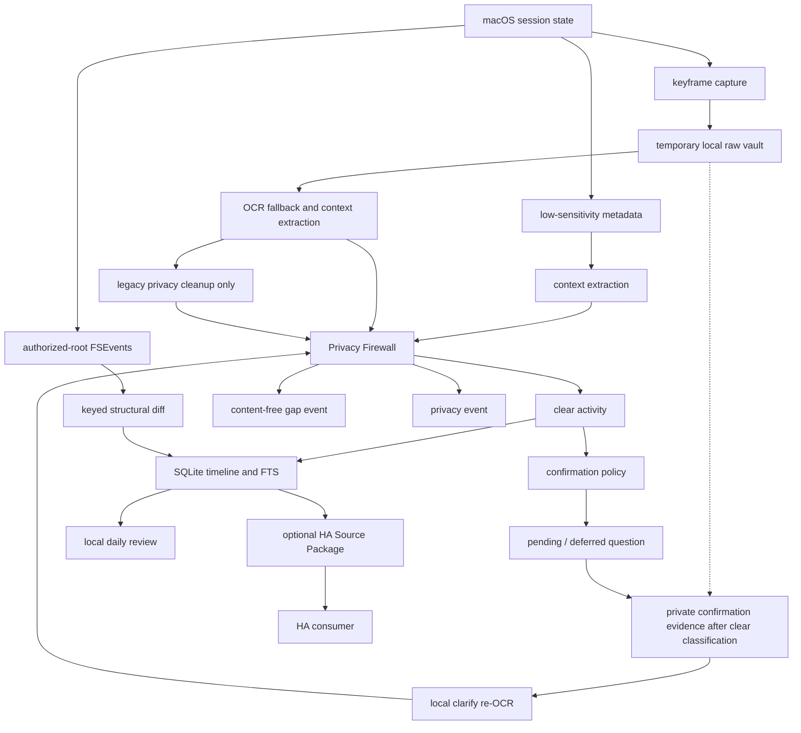

# Architecture

Personal AI Monitor is intentionally local-first. The first public version separates the
native macOS app shell from the local `personal-ai-monitor-core` engine and keeps HA as an
optional export path.

## Components

- `apps/PersonalAIMonitorMenuBar`: native macOS menu bar Alpha shell. It calls the core
  command channel and does not read SQLite tables directly.
- `activity_mvp.macos_probe`: macOS context and keyframe adapters.
- `activity_mvp.privacy`: local classification and redaction rules.
- `activity_mvp.pipeline`: ingestion, timeline, search, and coverage records.
- `activity_mvp.activity_confirmations`: grouped, revision-checked local activity
  questions, five-minute business episodes, three-level answers, manual omission
  capture, settlement revisions, and contract v4 output.
- `activity_mvp.confirmation_evidence`: schema-28 source-bound evidence promotion,
  private file locking, content-free availability/health, lifecycle release, and
  `delete_pending` reconciliation.
- `activity_mvp.legacy_review_cleanup`: privacy-only cleanup of retired visual
  review files, with durable deletion-failure receipts and no queue processing.
- `activity_mvp.daily_review`: local daily review over `clear` activity only.
- `activity_mvp.document_changes`: authorized-root file events, keyed baselines,
  format-aware safe summaries, coverage gaps, and read-only export contracts.
- `activity_mvp.ha_source`: optional HA Source Package generation, validation,
  revocation, and retention.
- `activity_mvp.lifecycle`: time-range deletion, cascade cleanup, and
  user-facing cleanup summaries.
- `activity_mvp.server`: development-only local dashboard.
- `activity_mvp.daemon`: keyframe capture loop, Off-the-record pause modes,
  coverage health, status explanations, retention cleanup, raw vault cleanup,
  and LaunchAgent helpers.

## Competitor-Informed Direction

- ActivityWatch and ManicTime inform the metadata-first layer: app, window,
  URL, AFK, virtual desktop, coverage health, and project tag seeds should be
  useful before visual capture is needed.
- ActivityWatch-style browser watchers inform URL and risk signals: browser
  extension data should replace long-term AppleScript fallback for URL,
  private-mode, risky-domain, login, and payment context.
- screenpipe and TimeScroll inform the structured-extraction layer: prefer
  Accessibility or browser-extension text where reliable, then use OCR only as
  fallback for inaccessible regions, visual state, and review.
- Familiar informs retention: raw keyframes are temporary; cleared text,
  activity facts, statistics, and deletable provenance are the durable layer.
- screenpipe-style agent access informs the MCP direction: expose only a narrow
  read-only `clear_only` activity package, never raw images, OCR source text,
  paths, or sensitive window details.
- Recall informs user control: status, pause, filter, and delete controls are
  product-critical trust surfaces, not advanced settings.
- ManicTime-style Off the record maps to 15-minute, until-next-lock, and
  today-only pause modes; all pause modes block keyframe/OCR/summary writes.

## Storage

SQLite is the local state store. Runtime state is excluded from version control.
Schema 28 adds business-episode metadata, safe signal fields, three-level answer
metadata, and confirmation-settlement revisions while preserving schema-27
source-bound evidence references. Public activity-confirmation contract v4
exposes only post-firewall text and content-free evidence availability and keeps
`raw_access=false`. The schema also keeps the legacy
`distribution_packages` table name for compatibility, while package semantics
are HA-only.

## Current Constraints

- Public positioning is keyframe-only, not short video buffering.
- Every connected display is keyframe-captured and OCR processed before local
  Privacy Firewall classification.
- Ordinary source frames are removed after processing. Only a clear source that
  creates a high-value occurrence question may be promoted into the private
  `confirmation_evidence.noindex` vault. It has no independent TTL, but terminal
  answers, explicit deletion, and privacy/system terminal paths release it;
  ordinary today-and-yesterday retention holds unresolved sources instead of
  silently deleting their questions. Unlink failure remains `delete_pending`
  for reconciliation.
- `clarify` may re-open only evidence referenced by that question, rerun local
  OCR, and route the new output through Privacy Firewall. Old cards without a
  schema-27 reference return `evidence_unavailable`; App and external consumers
  never receive the image, path, hash, or pre-filter OCR.
- Lock screen mode does not capture new screen images. Retired visual-review
  jobs remain historical records and are never processed or replayed. Necessary
  legacy file cleanup preserves retention policy and durable deletion failures.
- The dashboard is a debug UI, not the public app UI.
- Local OCR and the conservative Privacy Firewall remain active.
- Structured signals have landed in the core as a privacy-filtered extraction
  layer: browser URL/domain signals, Accessibility-first text, and foreground
  DocumentSignal context can augment OCR. Confirmed document changes are a
  separate authorized-root FSEvents path. Neither stores raw URL, absolute file
  path, full document text, or complete diffs.
- Structured-signal production hardening, semantic search, and broader
  MCP/Agent `clear_only` access remain roadmap work rather than Open Alpha
  requirements.
